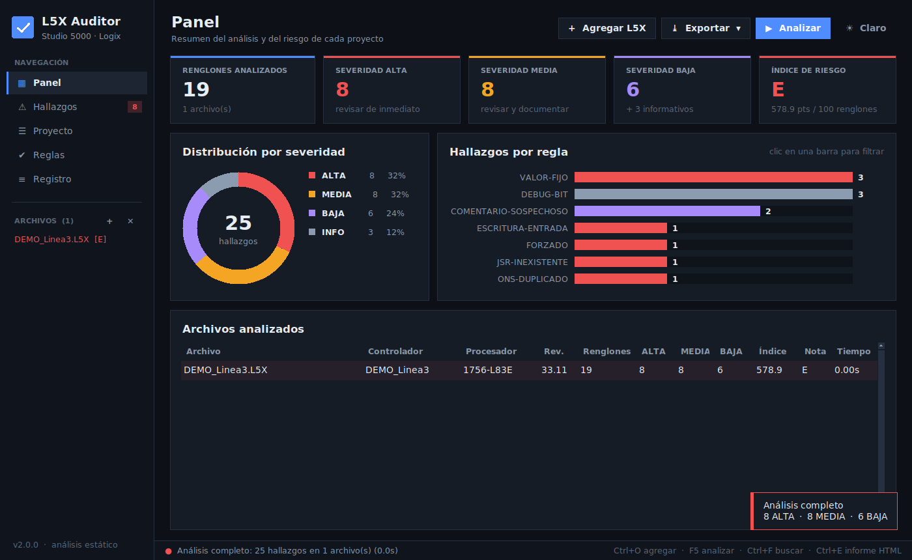
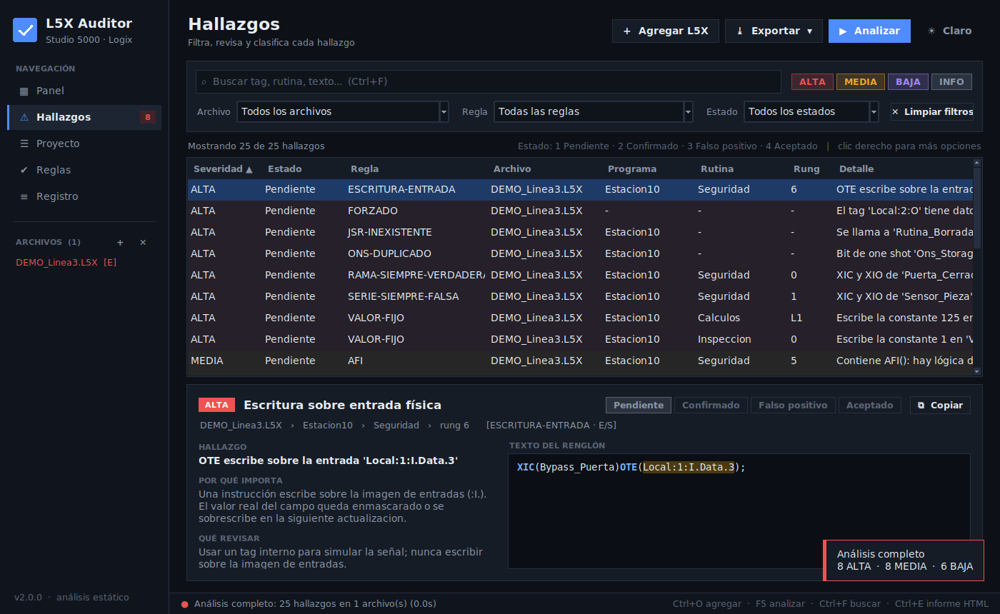
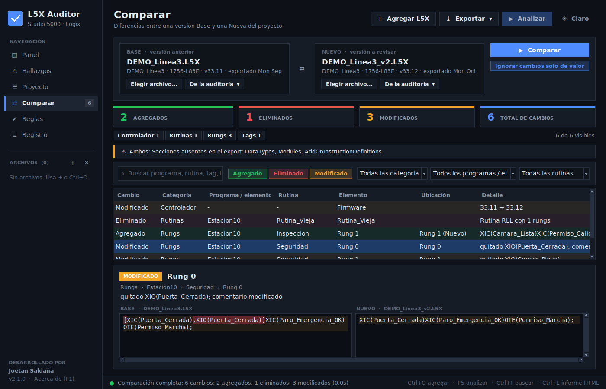

# L5X Auditor

**Desarrollado por Joetan Saldaña** · © 2026 Joetan Saldaña. Todos los derechos reservados.

Herramienta de **análisis estático** para proyectos de Rockwell **Studio 5000 / Logix Designer**
exportados a `.L5X`. Detecta patrones que suelen indicar lógica puenteada, deshabilitada,
forzada o mal escrita, y genera informes listos para compartir.

> Cada hallazgo debe confirmarse en el contexto de la máquina. La herramienta no sustituye
> una revisión manual.





## Características

- **Interfaz moderna** con tema oscuro y claro, panel con indicadores, gráficos y un índice de riesgo por proyecto.
- **Tabla de hallazgos** con búsqueda, filtros por severidad, archivo, regla y estado, ordenamiento por columna
  y un panel de detalle con el texto del renglón resaltado, *por qué importa* y *qué revisar*.
- **Flujo de revisión**: marca cada hallazgo como *Confirmado*, *Falso positivo* o *Aceptado* (teclas 1 a 4).
  Los estados se guardan automáticamente y se incluyen en los informes.
- **Vista de proyecto**: datos del controlador, programas, tareas y las instrucciones que más se usan.
- **Comparador de versiones**: muestra qué se agregó, eliminó o modificó entre dos L5X del mismo proyecto,
  con diff lado a lado de rungs y ST. Ver [Comparador](#comparador).
- **Reglas configurables**: puedes activar o desactivar cada regla, y la selección se recuerda.
- **Informes** en HTML (interactivo, se puede imprimir), Excel, CSV y JSON.
- **Modo consola** para automatizar la revisión (por ejemplo en CI), con un código de salida según la severidad.
- **Proyecto demo** incluido para probar la herramienta sin tener un L5X a mano.
- Usa solo la biblioteca estándar de Python.

## Reglas

| Severidad | Código | Qué detecta |
|---|---|---|
| ALTA | `RAMA-SIEMPRE-VERDADERA` | XIC y XIO del mismo tag en ramas paralelas (interlock anulado) |
| ALTA | `SERIE-SIEMPRE-FALSA` | XIC y XIO del mismo tag en serie (el renglón nunca conduce) |
| ALTA | `VALOR-FIJO` | Constante escrita en resultados de inspección/medición (RLL y ST) |
| ALTA | `ONS-DUPLICADO` | Bit de almacenamiento de ONS/OSR/OSF reutilizado |
| ALTA | `ESCRITURA-ENTRADA` | Escritura sobre la imagen de entradas físicas (`:I.`) |
| ALTA | `JSR-INEXISTENTE` | JSR/FOR a una rutina que no existe |
| ALTA | `FORZADO` | Tags con datos de forzado activos en el export |
| MEDIA | `AFI` | Lógica deshabilitada con `AFI()` |
| MEDIA | `TIMER-PRE-0` | Preset de temporizador cargado con 0 |
| MEDIA | `OTE-DUPLICADA` | Doble bobina: la misma OTE en varios renglones |
| MEDIA | `OTL-SIN-OTU` | Enclavamiento sin desenclavamiento en el mismo programa |
| MEDIA | `TIMER-DUPLICADO` | El mismo temporizador en varias instrucciones |
| MEDIA | `TAREA-INHIBIDA` | Tarea marcada como inhibida |
| MEDIA | `PROGRAMA-DESHABILITADO` | Programa deshabilitado |
| MEDIA | `ST-CONDICION-CONSTANTE` | `IF 1 THEN`, `WHILE TRUE DO`… en texto estructurado |
| BAJA | `JMP` | Saltos JMP/LBL |
| BAJA | `COMENTARIO-SOSPECHOSO` | Comentarios que mencionan bypass, puente, prueba, temporal… |
| BAJA | `RUTINA-SIN-LLAMAR` | Rutinas que ningún JSR llama |
| BAJA | `PROGRAMA-SIN-TAREA` | Programas no asignados a ninguna tarea |
| INFO | `DEBUG-BIT` | Bits de debug/bypass que condicionan lógica, con su valor actual |

## Requisitos

- Python 3.8 o superior, con Tkinter (viene incluido en el instalador oficial de Windows).
- Opcional: `pip install -r requirements-optional.txt`
  - `openpyxl` para exportar a Excel.
  - `tkinterdnd2` para arrastrar y soltar archivos sobre la ventana.

## Uso

### Interfaz gráfica

```bash
python l5x_auditor_gui.py
```

1. En Studio 5000: **File > Save As > Logix Designer XML File (\*.L5X)**.
2. Agrega uno o varios `.L5X` (**+ Agregar L5X** o `Ctrl+O`) y pulsa **Analizar** (`F5`).
3. Revisa el **Panel**. Haz clic en un indicador o en una barra para filtrar los hallazgos.
4. En **Hallazgos**, clasifica cada uno y exporta el informe (`Ctrl+E` genera el HTML).

| Atajo | Acción |
|---|---|
| `Ctrl+O` | Agregar archivos |
| `F5` | Analizar |
| `Ctrl+F` | Buscar en los hallazgos |
| `Ctrl+E` | Informe HTML |
| `1` a `4` | Pendiente / Confirmado / Falso positivo / Aceptado |
| `Ctrl+C` | Copiar el hallazgo seleccionado |
| Clic derecho | Menú contextual (filtrar o desactivar la regla) |

### Consola

```bash
python l5x_auditor_gui.py proyecto.L5X                         # resumen en pantalla
python l5x_auditor_gui.py *.L5X --html informe.html --csv r.csv
python l5x_auditor_gui.py proyecto.L5X --min-sev MEDIA --xlsx r.xlsx
python l5x_auditor_gui.py proyecto.L5X --disable JMP --disable AFI
python l5x_auditor_gui.py proyecto.L5X --fail-on ALTA          # sale con código 2 si hay hallazgos ALTA
python l5x_auditor_gui.py --list-rules
python l5x_auditor_gui.py --demo --html demo.html
python l5x_auditor_gui.py --compare v1.L5X v2.L5X --html cambios.html --xlsx cambios.xlsx
```

## Comparador



La auditoría sigue funcionando con un solo archivo. La página **Comparar** recibe dos: **Base** (la versión
anterior) y **Nuevo** (la versión a revisar).

- Cada archivo se elige con *Elegir archivo…* o se toma de los ya cargados en la auditoría (*De la auditoría*,
  o clic derecho sobre un archivo de la lista lateral).
- La **Base se recuerda** entre sesiones y **Nuevo** se llena solo con el archivo que estás auditando, así que
  normalmente solo pulsas **Comparar** (`F5` en esa página).
- *Probar con ejemplo* genera dos versiones del proyecto demo para ver el comparador en acción.

**Qué compara**

| Categoría | Qué detecta |
|---|---|
| Controlador | Firmware, procesador, versión de Studio 5000 y demás propiedades |
| Tareas | Tipo, periodo, prioridad, watchdog, inhibición y programas asignados (en orden) |
| Programas | Programas agregados o eliminados; rutina principal, de fallas, deshabilitado |
| Rutinas | Rutinas RLL, ST, FBD y SFC agregadas o eliminadas, cambio de tipo, cambios en FBD/SFC |
| Rungs | Rungs agregados, eliminados o modificados, con las instrucciones que cambiaron |
| Comentarios | Comentarios de rung modificados |
| ST | Líneas de texto estructurado agregadas, eliminadas o modificadas |
| Tags | De controlador y de programa: tipo de dato, dimensiones, valor inicial, descripción, alias, radix |
| AOIs | AOIs agregadas o eliminadas, revisión, parámetros y tags locales, y sus rutinas |
| UDTs | UDTs agregados o eliminados y miembros agregados, eliminados o modificados |
| Módulos | Catálogo, revisión, IP, RPI, módulo padre, inhibido y keying |

**Cómo decide**

- Los rungs se emparejan **por contenido, no por número**: un rung insertado en medio aparece como un solo
  *Agregado* y los siguientes, que solo se renumeran, no se marcan como cambiados. Dentro de un bloque
  cambiado, cada rung se empareja con el más parecido del otro archivo; si se parecen menos de un 50 %, se
  reportan como eliminado y agregado.
- **Se ignoran** fechas de export y de modificación, `CommPath`, el orden de los atributos XML, los espacios
  y sangrías, y los atributos que una versión de Studio 5000 escribe y otra no cuando tienen el valor por omisión.
- **Valores de tags**: la opción *Ignorar cambios solo de valor* viene activada, porque los valores en vivo
  (contadores, timers) cambian en cada export. Desactívala para verlos (`--incluir-valores` en consola).
- Si a uno de los archivos le falta una sección (por ejemplo, un export parcial o de una versión antigua),
  esa categoría no se compara y se muestra un **aviso** en lugar de reportar todo como eliminado.
- Las rutinas y AOIs protegidas (*source protection*) solo indican si su contenido cambió.
- Los archivos se leen en segundo plano: un proyecto de 100,000 rungs se lee y compara en unos 3 segundos
  sin congelar la ventana.

**Informes**: HTML (filtrable, con el diff de cada cambio) y Excel (hojas *Resumen*, *Cambios* y *Avisos*),
desde el botón *Exportar* de la barra superior. Con la opción *Exportar solo la vista filtrada* se exporta
únicamente lo que muestran los filtros.

## Índice de riesgo

Cada hallazgo suma puntos según su severidad (ALTA = 10, MEDIA = 3, BAJA = 1). El total se normaliza
por cada 100 renglones o líneas de ST y se traduce a una nota: **A** (< 2), **B** (< 8), **C** (< 20),
**D** (< 45) o **E**. Es un indicador orientativo que sirve para comparar proyectos y priorizar la revisión.

## Ejecutable para Windows

En Windows, con Python en el PATH, abre una terminal en la carpeta del proyecto y ejecuta:

```bat
build_exe.bat           :: dist\L5X_Auditor.exe  (un solo archivo)
build_exe.bat onedir    :: dist\L5X_Auditor\     (carpeta; abre más rápido y el antivirus la marca menos)
```

El ejecutable incluye:

- **Ícono propio** (`assets/l5x_auditor.ico`). Para regenerarlo: `python tools/make_icon.py`.
- **Datos de autor** de `version_info.txt`, visibles en *clic derecho > Propiedades > Detalles*:
  compañía y copyright a nombre de Joetan Saldaña, descripción y versión.
- No hace falta tener Python en el equipo destino.

### Firma digital (opcional)

Windows solo muestra el editor como verificado si el `.exe` está firmado con un **certificado de firma de
código** (Authenticode) emitido por una autoridad certificadora, como DigiCert, Sectigo o SSL.com.
Si tienes uno en formato `.pfx` y el Windows SDK instalado (incluye `signtool`), el script lo firma solo:

```bat
set SIGN_PFX=C:\ruta\certificado.pfx
set SIGN_PASS=tu_contraseña
build_exe.bat
```

Sin certificado, el `.exe` se genera igual (con el autor en *Detalles*), pero SmartScreen lo mostrará como
"editor desconocido".

## Pruebas

```bash
python -m unittest discover -s tests -v
```

- `tests/test_engine.py`: reglas de auditoría, informes y consola.
- `tests/test_compare.py`: compara `tests/fixtures/cmp_base.L5X` con `cmp_nuevo.L5X`, que tienen 29 cambios
  conocidos más diferencias puramente cosméticas, y exige que se detecten exactamente esos 29. También prueba
  secciones faltantes, exports parciales, rutinas protegidas y un rung insertado en una rutina de 3,000 rungs.

## Datos locales

La configuración (tema, reglas activas, carpetas recientes) y los estados de revisión se guardan en
`%APPDATA%\L5XAuditor` en Windows, o en `~/.config/L5XAuditor` en Linux y macOS. Nunca se modifica el archivo L5X.
